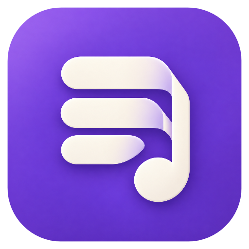

# LyriBeam · 蓝牙歌词

**Live desktop lyrics for music playing on your phone.**

手机照常播放音乐，LyriBeam 将歌曲信息与播放进度通过蓝牙传给电脑，在 Windows 桌面显示同步歌词。音乐声音仍由手机原来的输出设备播放，无需部署中转服务器。

This repository contains the Windows desktop app and Android companion. The phone sends playback metadata over Bluetooth; the desktop finds and validates synchronized lyrics. Source code and build instructions are separated by platform below.

## 桌面端与移动端

| 目录 | 内容 | 当前源码版本 | 入口 |
|---|---|---|---|
| [`desktop/`](desktop/README.md) | Windows WPF 桌面歌词、匹配引擎、托盘、图标及离线回归 | 0.8.15 | [`desktop/windows/LyricBridge.csproj`](desktop/windows/LyricBridge.csproj) |
| [`mobile/`](mobile/README.md) | Android 歌曲读取、蓝牙同步、首次引导及播放器接入 SDK | 0.4.6 | [`mobile/android/AndroidManifest.xml`](mobile/android/AndroidManifest.xml) |
| [`docs/`](docs/ARCHITECTURE.md) | 数据链路、兼容范围与隐私说明 | — | [架构](docs/ARCHITECTURE.md) · [隐私与本地数据](docs/PRIVACY.md) |
| `assets/` | 项目展示图标 | — | 当前 Windows 柔和版 B 图标 |

```text
lyribeam/
├── desktop/
│   ├── windows/             # C# / WPF 源码与回归检查
│   └── design/app-icon/     # 当前桌面图标母图与导出脚本
├── mobile/
│   ├── android/             # Android Java 源码、资源与主机检查
│   ├── developer/           # 可选播放器主动接入 SDK
│   └── scripts/             # JDK / Android SDK 环境发现
├── docs/
└── assets/
```

## 功能

- 当前句与下一句歌词、卡片或纯文字模式、字体与颜色、置顶、鼠标穿透和托盘菜单。
- 暂停、继续、切歌及歌曲进度跟随；每首歌可独立保存歌词偏移。
- 自动识别音乐播放器，保留手动选择；标准媒体会话之外，提供保守音乐通知回退和可选开发者主动接入。
- 优先使用授权播放器提供的可信歌词与已验证缓存；联网时原平台优先，多来源并行准备。
- 酷狗、QQ音乐、网易云与通用搜索共用版本、歌手、时长、正文、时间轴、缓存和诊断校验。

支持程度取决于播放器提供的信息。只有歌名而没有可靠进度时，无法保证逐句同步；未公开媒体状态的小播放器可通过现有 SDK 接入。曲库收录、第三方接口可用性及同曲不同版本都会影响歌词命中。

## 开始使用

1. 根据[桌面构建说明](desktop/README.md)构建并运行 Windows 应用。
2. 根据[手机构建说明](mobile/README.md)构建 Android 助手并安装到手机。
3. 在系统蓝牙设置中配对手机与电脑。
4. 手机首次按引导授权歌曲读取与蓝牙连接，并选择电脑；日常进入首页点“开始同步”。

日常使用不需要 USB。手机声音不经过本工具转发。手机后台被系统结束时，可以打开助手点击“恢复同步”；自动恢复受设备策略影响。

当前提交提供源码与构建方法，不附带运行数据、工具链或安装包。桌面程序集仍名为 `LyricBridge`，Android 包名仍为 `com.local.lyricbridge`，以保留现有协议与升级兼容。Android 当前图标沿用 0.4.6 资源，桌面新 B 图标尚未同步到 Android。

## 开发与检查

- 桌面：Windows、.NET 10 SDK、PowerShell；见[构建和离线回归](desktop/README.md)。
- 手机：JDK 17、Android SDK Platform 35 / Build Tools；主机检查只需要 JDK。见[移动端检查](mobile/README.md#检查)。
- 自建播放器：见[主动接入 SDK](mobile/developer/README.md)。
- 修改约定：见[参与开发](CONTRIBUTING.md)。

本仓库不包含开发签名私钥、歌词缓存、听歌记录、设备标识或本机验证截图。隐私相关的数据流见[说明](docs/PRIVACY.md)。

## License

许可证待作者确定，当前未附 `LICENSE`。
